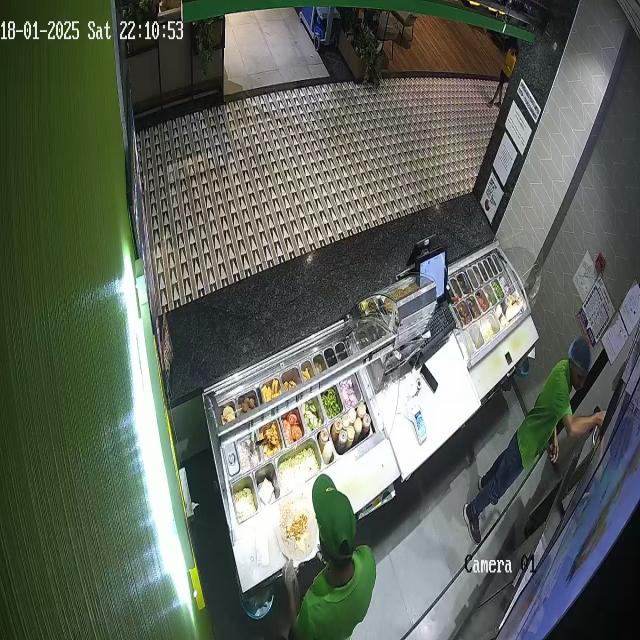
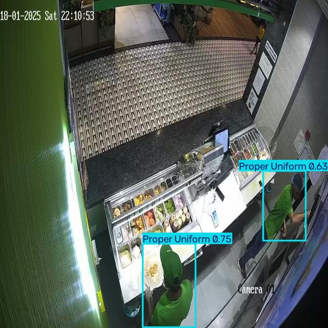

# YOLOv8-Based Uniform Compliance Detection

## Overview

This project uses a custom-trained YOLOv8n object detection model to identify two uniform categories: Proper Uniform and Improper-Uniform.

The model was trained on an annotated image dataset and evaluated on a separate test set. It generates bounding boxes, class labels, and confidence scores for detected objects.

## Features

* Custom object detection with YOLOv8n
* Two classes: Proper Uniform and Improper-Uniform
* Pascal VOC XML to YOLO annotation conversion
* Batch prediction on test images
* Evaluation using precision, recall, and mean Average Precision (mAP)

## Example Prediction

The trained YOLOv8n model predicts uniform categories and displays
bounding boxes, class labels, and confidence scores.

### Input Image


### Model Prediction


## Technologies Used

* Python
* Ultralytics YOLOv8
* PyTorch
* OpenCV

## Dataset

The dataset contains images split into training, validation, and testing sets.

* Training images: 2,868
* Validation images: 200
* Test images: 99

The dataset annotations were converted from Pascal VOC XML format to YOLO format. Refer to the original dataset source and its license before downloading or redistributing the data.

## Model Evaluation

The model was trained for 5 epochs using YOLOv8n and evaluated on the 99-image test set.
 ___________|_________
|   Metric	|   Score |
|Precision	| 0.854   |
|Recall	    | 0.753   |
|mAP@50	    | 0.861   |
|mAP@50–95	| 0.524   |
|___________|_________|
These results are baseline evaluation metrics. Performance may vary on unseen images and real-world CCTV footage.

## Project Structure

uniform-detection/
├── examples/
│   ├── input.jpg
│   └── prediction.jpg
├── weights/
│   └── best.pt
├── .gitignore
├── predict.py
├── requirements.txt
└── README.md

### Installation

1. Clone this repository:

```bash
git clone [(https://github.com/kripa-sharma09/yolov8-uniform-detection)]
cd uniform-detection
```

2. Install the dependencies:
```bash
python -m pip install -r requirements.txt
```

3. Download or obtain the trained model weights and place best.pt inside the weights/ folder.
4. Place an input image at examples/input.jpg.

### Run Prediction

Run the following command to detect uniforms in an image:

```bash
 python predict.py --source "examples/input.jpg"
```
To predict on a different image, provide its file path:

```bash
 python predict.py --source "path/to/your/image.jpg"
```

The model detects proper and improper uniforms and displays bounding boxes, class labels, and confidence scores.

The annotated prediction image is saved in the generated runs/detect/ directory.

## Limitations

* The model was trained for only 5 epochs.
* Predictions may contain false detections or missed objects.
* Performance on real-world CCTV footage has not been independently established.

Future Improvements

* Experiment with additional training epochs and hyperparameters.
* Evaluate on a wider range of lighting conditions, camera angles, and uniform types.
* Analyze class-wise performance and confusion matrices.
* Explore video-based detection.

### Author

Kripa Sharma